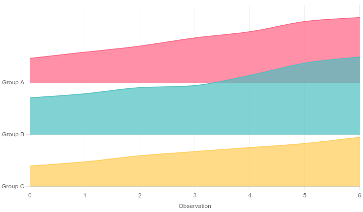

# chartjs-chart-ridgeline

A [Chart.js](https://www.chartjs.org) chart type for **ridgeline plots** (joyplots), inspired by the
[D3 ridgeline plot](https://observablehq.com/@d3/ridgeline-plot): several smooth, filled curves stacked
vertically, with configurable overlap, spacing, amplitude and colors.



The chart is a regular Chart.js dataset controller (`type: 'ridgeline'`): it uses the native scales, tooltips,
legend, animations and option resolution (scriptable and indexable options), and works with Chart.js 4.

## Installation

```sh
npm install chart.js chartjs-chart-ridgeline
```

## Usage

Register the controller and its element, along with the scale and plugins you use:

```js
import { Chart, LinearScale, Legend, Tooltip } from 'chart.js';
import { RidgelineController, RidgeElement } from 'chartjs-chart-ridgeline';

Chart.register(RidgelineController, RidgeElement, LinearScale, Legend, Tooltip);
// or, to register everything Chart.js ships with:
// import { Chart, registerables } from 'chart.js';
// Chart.register(...registerables, RidgelineController, RidgeElement);

new Chart(document.getElementById('chart'), {
  type: 'ridgeline',
  data: {
    labels: ['Group A', 'Group B', 'Group C'],
    datasets: [
      {
        label: 'Distribution',
        data: [
          [12, 15, 18, 22, 25, 30, 32],
          [18, 20, 23, 24, 29, 35, 38],
          [10, 12, 15, 17, 19, 21, 24],
        ],
      },
    ],
  },
});
```

In the browser, without a bundler, load the UMD builds (Chart.js first). The package is exposed as
`ChartRidgeline`:

```html
<script src="https://cdn.jsdelivr.net/npm/chart.js@4"></script>
<script src="https://cdn.jsdelivr.net/npm/chartjs-chart-ridgeline"></script>
<script>
  Chart.register(ChartRidgeline.RidgelineController, ChartRidgeline.RidgeElement);
</script>
```

## Data

Every label is a ridge, and every item of `data` is the array of observations of that ridge. The observations
are drawn as they are: they are not binned or smoothed into a density estimate, the curve just goes smoothly
through them.

- The first label is drawn at the top, the last one at the bottom. Ridges are painted from top to bottom, so
  the lower ones overlap the upper ones.
- The observations of a ridge are evenly spaced along the x axis, the x value of an observation is its index.
  Ridges may have a different number of observations.
- The height of a ridge at an observation is proportional to its value. All the ridges of a dataset share the
  same scale: the tallest observation of the dataset gets the tallest peak. Values are expected to be positive,
  and values that are not finite numbers are drawn as `0`.

## Options

The following options are dataset options, so they can also be set for all the ridgeline datasets of a chart
with `options.datasets.ridgeline`, or globally with `Chart.defaults.datasets.ridgeline`.

- `overlap` (default `1.5`): height of the tallest ridge, in units of the default `spacing`. At `1` the tallest
  peaks reach the baseline above them, above `1` the ridges overlap. The y axis reserves this room above every
  baseline.
- `spacing` (default `1`): distance between two consecutive baselines, in y axis units. Increasing it moves the
  ridges apart, reducing their overlap.
- `amplitude` (default `1`): gain applied to the height of every ridge. Below `1` the ridges are flattened
  without moving the baselines, above `1` they are exaggerated and the y axis grows to fit them.

Colors and style are the usual Chart.js line options. Each of them can be a scriptable function, and an array
gives a different value to each ridge:

- `backgroundColor` (default `rgba(54, 162, 235, 0.7)`): fill color of the ridges.
- `borderColor` (default `rgb(54, 162, 235)`) and `borderWidth` (default `1.5`): color and width of the line
  that follows the peaks. A `borderWidth` of `0` hides it.
- `cubicInterpolationMode` (default `'monotone'`) and `tension` (default `0.4`): `'monotone'` never overshoots
  the observations. With `'default'`, `tension` sets the smoothness, and `0` draws straight segments.
- `borderDash`, `borderDashOffset`, `borderCapStyle` and `borderJoinStyle`: style of the line.
- The `hover*` variants, for instance `hoverBackgroundColor`, apply when a ridge is hovered.
const palette = ['255, 99, 132', '75, 192, 192', '255, 205, 86'];

const dataset = {
  data,
  overlap: 2,
  spacing: 1,
  amplitude: 0.8,
  backgroundColor: palette.map((rgb) => `rgba(${rgb}, 0.7)`),
  borderColor: palette.map((rgb) => `rgb(${rgb})`),
  // or a function: backgroundColor: (context) => colors[context.dataIndex]
};
```

## Scales, tooltips and legend

- `x` is a linear scale showing the index of the observations. `y` is a linear scale whose ticks are placed on
  the baselines of the ridges and labeled with the chart labels. Configure them as any other scale, for
  instance `options.scales.x.title`. Avoid overriding `ticks.callback` and `afterBuildTicks` of the `y` scale,
  they position the labels.
- Hovering a ridge shows the label of the ridge and its observations in the tooltip. The interaction modes of
  Chart.js work as usual.
- The legend item of the dataset uses the style of the first ridge.

## TypeScript

The package ships its declarations. Importing it adds `ridgeline` to Chart.js' `ChartTypeRegistry`, so charts,
datasets and options are typed:

```ts
import { Chart, type ChartConfiguration } from 'chart.js';
import { RidgelineController, RidgeElement } from 'chartjs-chart-ridgeline';

Chart.register(RidgelineController, RidgeElement);

const config: ChartConfiguration<'ridgeline'> = {
  type: 'ridgeline',
  data: { labels: ['A', 'B'], datasets: [{ data: [[1, 2, 3], [3, 2, 1]], overlap: 2 }] },
};
```

## Example

[`examples/basic.html`](examples/basic.html) renders the chart above with controls for `overlap`, `spacing`,
`amplitude` and the colors. Build the package and open the file in a browser:

```sh
npm install
npm run build
```

## Development

| Command             | Description                                                      |
| ------------------- | ---------------------------------------------------------------- |
| `npm test`          | Runs the tests (Vitest, rendering on a node canvas).             |
| `npm run typecheck` | Type checks the sources and the tests.                           |
| `npm run build`     | Builds ESM, CommonJS and UMD bundles and the declarations in `dist`. |

## License

[MIT](LICENSE)
